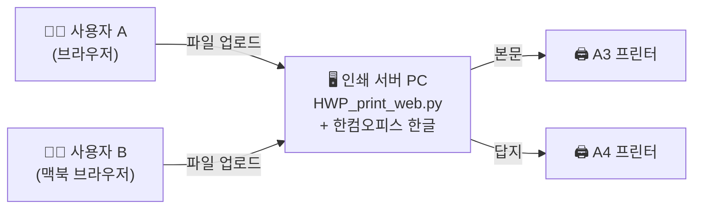

# 📄 DYMT — 한글(HWP) 본문/답지 분할 인쇄 서버

한글(HWP) 문서의 **첫 번째 미주(Endnote)** 를 자동으로 찾아, 그 페이지를 기준으로
**본문(A3)** 과 **답지(A4)** 를 서로 다른 프린터로 한 번에 분할 인쇄하는 도구입니다.

웹 기반이라 **프린터가 연결된 Windows PC 한 대만 서버로 켜두면**,
같은 네트워크의 누구나(윈도우·맥·폰) 브라우저로 접속해 사용할 수 있습니다.



## 주요 기능

- **다중 파일 업로드** — .hwp / .hwpx 여러 개를 한 번에 올리고, 파일별로 설정
- **파일별 분할/전체 모드** — 분할 ON: 첫 미주 기준으로 본문·답지를 나눠 각각 다른
  프린터로 / 분할 OFF: 전체를 양쪽 프린터로 통째로 인쇄
- **파일별 부수 지정** — 본문·답지 부수를 각각 지정 (0부 입력 시 해당 쪽은 건너뜀)
- **다중 사용자 대기열** — 여러 명이 동시에 접속해도 각자 자기 파일 목록만 보이며,
  인쇄 작업은 공용 대기열에 쌓여 순서대로 처리
- **실시간 공유 로그** — 누가 무엇을 몇 부 보냈는지, 진행 상황을 전원이 실시간 확인
- **자동 정리** — 인쇄가 끝난 업로드 파일은 서버에서 자동 삭제

## 요구 사항 (서버 PC)

| 항목 | 내용 |
|---|---|
| OS | Windows (한글 COM 자동화가 Windows 전용) |
| 프로그램 | 한컴오피스 한글(HWP) 설치 필수 |
| Python | 3.10 이상 권장 |
| 프린터 | 본문용(A3)·답지용(A4) 프린터 연결 — [프린터 설정 가이드](docs/프린터_설정_가이드.md) |

접속하는 쪽(사용자)은 **브라우저만 있으면 됩니다.** 맥북·스마트폰도 가능합니다.

## 설치

```bash
git clone https://github.com/jookite/DYMT.git
cd DYMT
pip install -r requirements.txt
```

## 실행

```bash
python HWP_print_web.py
```

또는 **`인쇄서버_시작.bat` 더블클릭.**

- 첫 실행 시 Windows 방화벽 팝업이 뜨면 **"허용"** 을 눌러야 다른 기기에서 접속됩니다.
- 실행하면 서버 PC에서는 브라우저가 자동으로 열리고, 화면 상단에
  `http://<서버IP>:8080` 형태의 **공유용 접속 주소**가 표시됩니다.

## 사용 방법

1. 브라우저로 접속 후 **이름**을 입력합니다 (공유 로그에 표시됨).
2. **본문(A3) / 답지(A4) 프린터**를 선택합니다.
3. 한글 파일을 **여러 개 업로드**합니다.
4. 파일별로 **분할 여부**와 **본문·답지 부수**를 입력합니다.
   (전부 1부씩이면 **"모두 1부"** 버튼)
5. **인쇄 시작** — 작업이 공용 대기열에 들어가고 순서대로 인쇄됩니다.

> ⚠️ 분할 모드인데 문서에 미주가 없으면 해당 파일은 인쇄하지 않고 건너뜁니다.
> 그런 파일은 '분할' 스위치를 끄면 전체 인쇄됩니다.

## 서버 운영 팁

- **상시 운영**: `Win + R` → `shell:startup` 폴더에 `인쇄서버_시작.bat` 바로가기를
  넣으면 PC 부팅 시 자동 시작됩니다.
- **고정 IP**: 공유기 DHCP 설정에서 서버 PC에 고정 IP를 지정해두면 접속 주소가
  바뀌지 않습니다.
- **네트워크 범위**: 사내망(같은 공유기) 전용입니다. **인터넷에 직접 공개하지 마세요.**
- **한글 팝업**: 한글 보안/오류 팝업은 서버 PC 화면에 뜨므로, 인쇄가 멈춘 것 같으면
  서버 화면을 확인하세요.

## 프로젝트 구조

```
DYMT/
├─ HWP_print_web.py          # 메인 프로그램 — 다중 사용자 웹 인쇄 서버
├─ 인쇄서버_시작.bat           # 서버 실행용 배치 파일
├─ requirements.txt          # 파이썬 의존성 (nicegui, pywin32)
├─ docs/
│  └─ 프린터_설정_가이드.md    # 프린터 수동 추가(IP 연결) 가이드
└─ legacy/                   # 이전 데스크톱(tkinter) 버전 보관
   ├─ start2zero.py          #   v1: 폴더 일괄 인쇄
   ├─ HWP_print_tool.py      #   v2: 파일 목록 + 폴더 일괄 (탭 UI)
   └─ HWP_split_print.py     #   v3: 분할/전체 모드 선택 추가
```

이전 버전들에 대한 설명은 [legacy/README.md](legacy/README.md)를 참고하세요.
